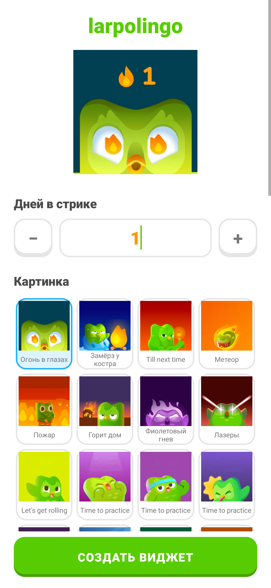
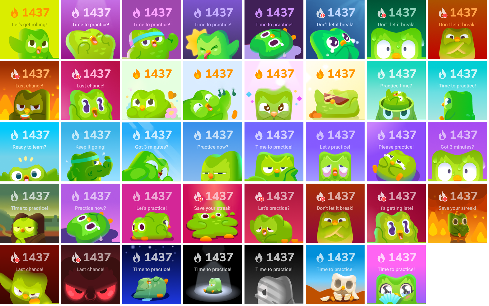

# larpolingo

Android-приложение с одной задачей: виджет «Ударный режим» (стрик) в стиле Duolingo на рабочем столе.

**Готовый APK:** [`larpolingo.apk`](larpolingo.apk) (Android 8.0+). Исходники лежат в `android/`, собираются командой `cd android && gradle assembleRelease`.

## Что можно настроить
- **Дней в стрике**: любое число до 999 999 999 (вводится вручную или кнопками −/+).
- **Картинка**: 47 картинок из настоящих виджетов Duolingo: 8 с присланных скриншотов и 39 из официального блога Duolingo (все состояния виджета: «Time to practice!», «Don't let it break!», «Last chance!», праздничные, стрик 0 и др.). При выборе картинки значок, цвет числа и подпись подставляются как в оригинале.
- **Значок**: огонь горит, огонь под угрозой (серый с красным «!»), контур или огонь в цвет числа.
- **Подпись**: без подписи, таймер до полуночи или свой текст (например, «Last chance!»).
- **Автоматический рост**: выкл, +1 в день, +10 в день или своё число. Стрик прибавляется в полночь, виджет обновляется сам (в том числе после перезагрузки телефона).

Кнопка **«СОЗДАТЬ ВИДЖЕТ»** добавляет виджет на рабочий стол. Если лаунчер так не умеет, добавьте его вручную: удерживайте палец на рабочем столе, затем «Виджеты» → larpolingo.

Картинки вырезаны из присланных скриншотов виджетов (старое число стёрто, приложение рисует своё), иконка сделана из присланного фото. Шрифт числа — Nunito (лицензия OFL).
